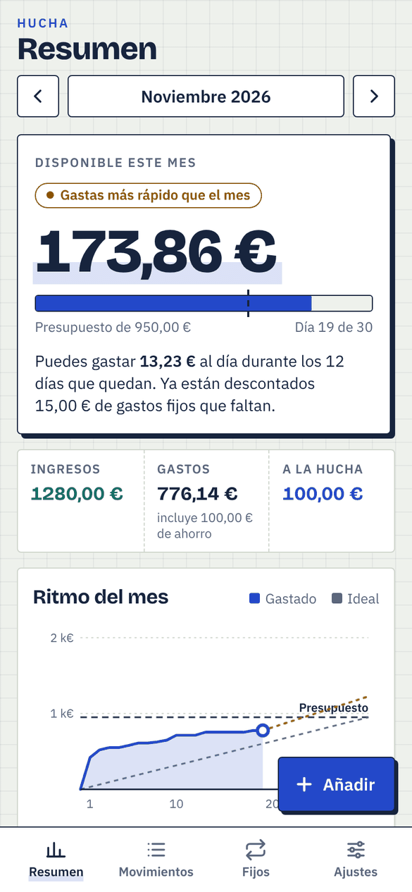
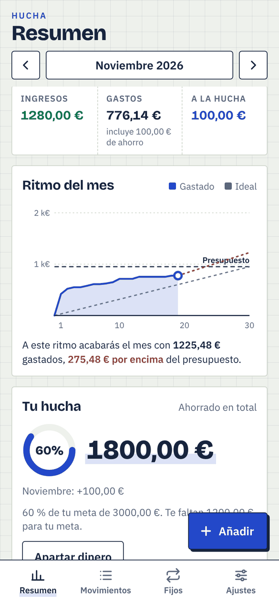
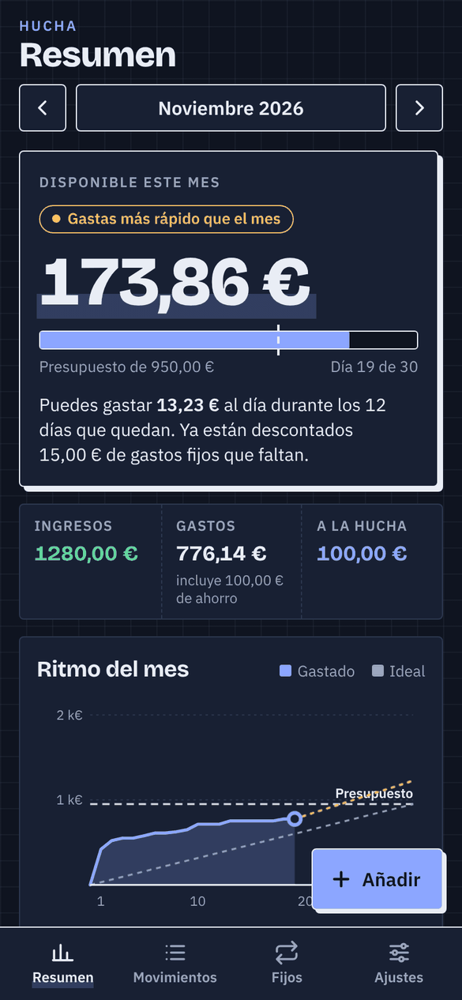
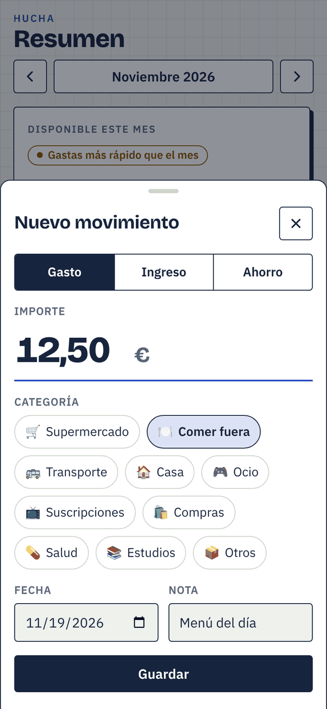
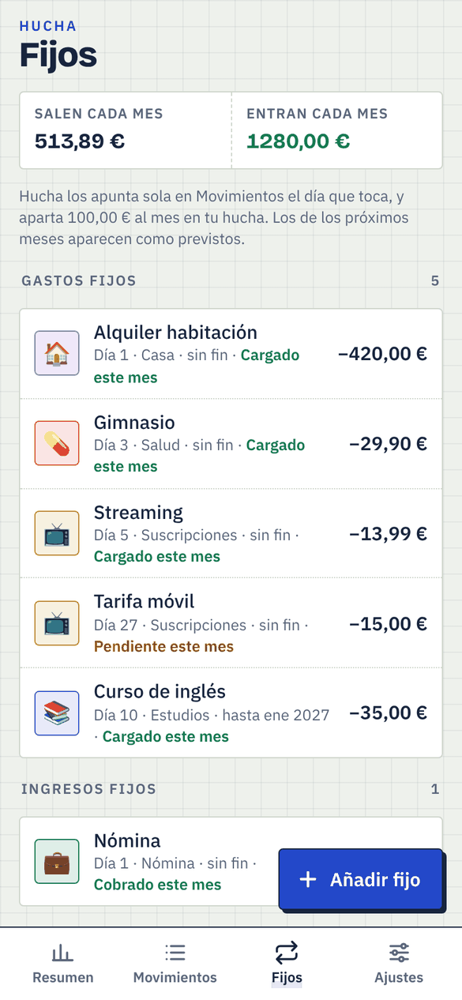
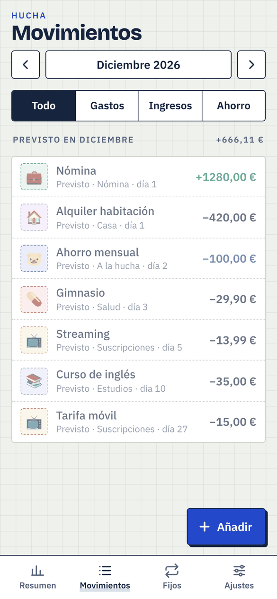
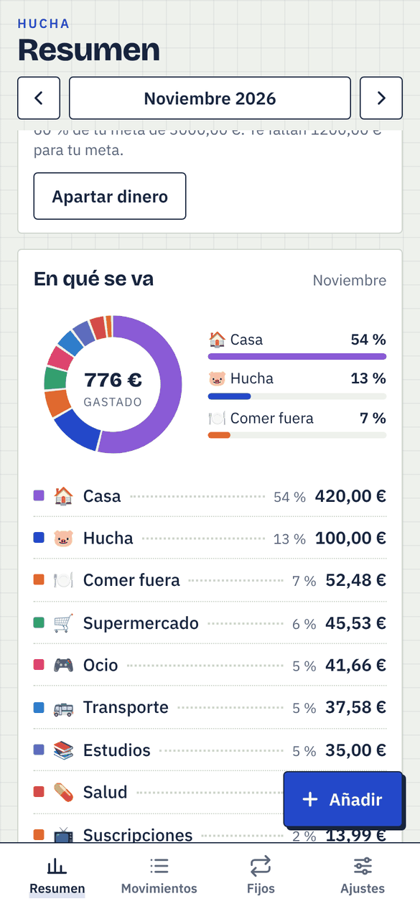
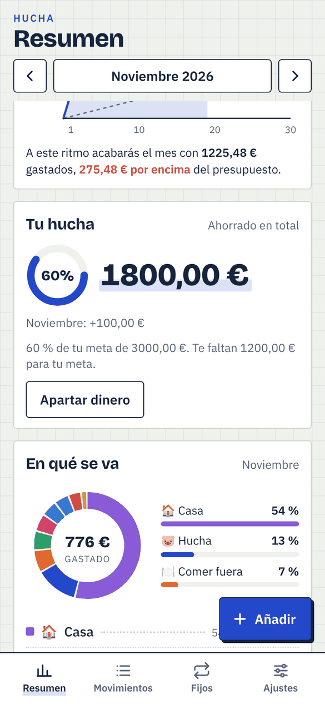
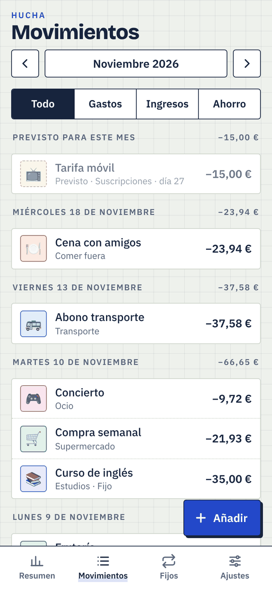

<div align="center">


# Hucha

**Controla tus gastos del mes desde el móvil: cuánto te queda, en qué se te va el dinero y cuánto llevas ahorrado.**

Gratis · Sin cuentas ni registros · Tus datos no salen de tu móvil · Funciona sin conexión

### [🤖 Descargar para Android (APK)](https://github.com/JesusCG12/Hucha/releases/latest/download/Hucha.apk) &nbsp;·&nbsp; [🍎 Abrir en iPhone o en el navegador](https://jesuscg12.github.io/Hucha/)

<br>

&nbsp;&nbsp;
&nbsp;&nbsp;


</div>

---

## ✨ Qué puedes hacer

| | |
|---|---|
| 💶 **Ver lo disponible** | Pones un presupuesto mensual y Hucha te dice, en grande, cuánto te queda este mes y cuánto puedes gastar al día sin pasarte. |
| 🧾 **Apuntar gastos e ingresos** | En dos toques: importe, categoría y listo. Puedes añadir una nota y cambiar la fecha. |
| 🔁 **Gastos fijos y suscripciones** | Alquiler, Spotify, el coche, la nómina… Los apuntas una vez y se añaden solos cada mes el día que toca. Eliges si duran siempre o solo unos meses. |
| 🔮 **Ver los próximos meses** | Los fijos que aún no han llegado salen como *previstos*, así sabes de antemano lo que te va a quedar. |
| 🐷 **Hucha de ahorro** | Apartas dinero cuando quieras (o cada mes, como fijo) y ves cuánto llevas en total y lo que te falta para tu meta. Lo que apartas se resta de lo disponible. |
| 📈 **Ritmo del mes** | Un gráfico con lo que llevas gastado día a día frente al ritmo ideal, y una previsión de cómo acabarás el mes si sigues así. |
| 🍩 **Saber en qué se va** | Donut con el reparto por categorías, límites por categoría (te avisa si te pasas) y barras de los últimos seis meses. |
| 🌙 **Modo oscuro** | Se pone solo si tu móvil lo usa. |

---

## 📲 Instalarla en el móvil

### 🤖 Android: app (APK)

1. Desde el móvil, descarga **[Hucha.apk](https://github.com/JesusCG12/Hucha/releases/latest/download/Hucha.apk)**.
2. Ábrelo desde la notificación de descarga o desde **Archivos → Descargas**.
3. Si Android te avisa de que no permite instalar apps de ese origen, pulsa **Ajustes**, activa **Permitir de esta fuente** y vuelve atrás.
4. Pulsa **Instalar**. Si Play Protect dice que es una app desconocida, elige **Instalar de todas formas** (es normal en apps que no vienen de Google Play).

Funciona sin conexión y no pide ningún permiso. Necesita Android 10 o posterior.

> [!NOTE]
> **Para actualizar**, descarga el APK nuevo con el mismo enlace e instálalo encima: tus datos se mantienen. Las versiones están en [Releases](https://github.com/JesusCG12/Hucha/releases).

### 🍎 iPhone (y cualquier navegador)

En iPhone, Hucha es una web que se instala como una app: icono en la pantalla de inicio, pantalla completa y funciona sin conexión. No hace falta App Store.

1. Abre **[jesuscg12.github.io/Hucha](https://jesuscg12.github.io/Hucha/)** en **Safari**.
2. Pulsa el botón **Compartir** (el cuadrado con la flecha hacia arriba).
3. Baja y elige **Añadir a pantalla de inicio** → **Añadir**.
4. Ábrela siempre desde el icono 🐷.

¿Prefieres no instalar el APK en Android? También puedes abrir la web en **Chrome** y usar **⋮ → Instalar app**.

> [!TIP]
> También puedes usarla en el ordenador, en cualquier navegador. Pero ojo: cada dispositivo guarda sus propios datos (mira [Tus datos](#-tus-datos)).

---

## 🚀 Primeros pasos

Al abrirla por primera vez verás **datos de ejemplo** para que te hagas una idea. Cuando quieras, pulsa **Empezar con mis datos** y se quedará vacía para ti.

1. **Ajustes → Presupuesto mensual.** Pon lo que te permites gastar al mes (con los fijos incluidos).
2. **Fijos → Añadir fijo.** Apunta lo que se repite: alquiler, suscripciones, gimnasio, la nómina… Elige el día del mes y cuánto dura (*Sin fin*, 3 meses, 12 meses…).
3. **Ajustes → Hucha de ahorro** (opcional). Pon lo que ya tenías ahorrado y, si quieres, una meta.
4. **Añadir.** Cada vez que gastes algo, apúntalo con el botón azul. Para guardar dinero, usa **Ahorro → Apartar a la hucha**.

<div align="center">
&nbsp;&nbsp;
&nbsp;&nbsp;

</div>

---

## 🧭 Las cuatro pestañas

**📊 Resumen.** Lo **disponible** del mes en grande, con una barra que marca el día de hoy para saber si vas bien de ritmo. Debajo: ingresos, gastos (con el ahorro incluido) y lo que has apartado; el **ritmo del mes** con la previsión de cómo acabarás; tu hucha con el anillo de la meta; el donut de categorías; y las barras de seis meses. Con las flechas cambias de mes, también a meses futuros para ver lo que te quedará.

**🧾 Movimientos.** Todo lo apuntado en el mes, agrupado por días. Puedes filtrar por gastos, ingresos o ahorro. Toca uno para editarlo o borrarlo. Arriba aparecen los fijos **previstos** que aún no han llegado.

**🔁 Fijos.** Lo que se repite cada mes, con su día, cuánto dura y si este mes ya se ha cargado o está pendiente. Puedes pausarlos, cambiarles la duración o borrarlos (lo ya apuntado no se toca).

**⚙️ Ajustes.** Presupuesto, hucha de ahorro, categorías (con su emoji, color y límite mensual), copia de seguridad y borrar todo.

<div align="center">
&nbsp;&nbsp;
&nbsp;&nbsp;

</div>

---

## 🔒 Tus datos

- **Todo se guarda en tu propio móvil**, dentro de la app. No hay servidor, ni cuenta, ni nadie más ve lo que apuntas (tampoco quien publica la app).
- Cada dispositivo y navegador guarda sus datos por separado.
- Si borras la app o los datos de Safari/Chrome, se borra lo que tenías. Por eso:

> [!IMPORTANT]
> Haz una copia de vez en cuando en **Ajustes → Exportar copia**. Se guarda un archivo `.json` con todo (en Android, en **Descargas/Hucha**). Con **Importar copia** lo recuperas, o lo pasas a otro móvil.

---

## ❓ Preguntas frecuentes

<details>
<summary><b>¿Tengo que volver a apuntar las suscripciones cada mes?</b></summary>
<br>
No. Apúntalas en <b>Fijos</b> y Hucha las añade sola cada mes el día que toca. Antes de que llegue ese día las verás como <i>previstas</i>. Si una suscripción solo dura unos meses, elige su duración al crearla.
</details>

<details>
<summary><b>¿El dinero que aparto a la hucha cuenta como gasto?</b></summary>
<br>
Sí: lo que apartas sale de lo disponible del mes y aparece sumado en «Gastos» (con la nota «incluye X € de ahorro»). Si luego sacas dinero de la hucha, vuelve a sumarse a lo disponible.
</details>

<details>
<summary><b>¿Funciona sin internet?</b></summary>
<br>
Sí. Después de abrirla una vez con conexión, funciona sin internet. Las actualizaciones se descargan solas la próxima vez que la abras con conexión.
</details>

<details>
<summary><b>¿Cómo la actualizo?</b></summary>
<br>
No tienes que hacer nada. Si quieres forzarlo, ábrela con conexión, ciérrala del todo (desliza hacia arriba en el multitarea) y vuelve a abrirla. Tus datos se mantienen.
</details>

<details>
<summary><b>He cambiado de móvil, ¿cómo paso mis datos?</b></summary>
<br>
En el móvil viejo: <b>Ajustes → Exportar copia</b> y envíate el archivo (por ejemplo, a tu correo o a la nube). En el nuevo: instala Hucha, ve a <b>Ajustes → Importar copia</b> y elige ese archivo.
</details>

<details>
<summary><b>¿Por qué no está en la App Store?</b></summary>
<br>
Porque no le hace falta: es una web instalable (PWA). Se instala desde el navegador, ocupa muy poco y se actualiza sola.
</details>

---

## 🛠️ Para curiosos

Hucha es una sola página web (`index.html`) con HTML, CSS y JavaScript, sin librerías ni servidor; los gráficos son SVG dibujados a mano. Los datos se guardan con `localStorage` y el `sw.js` (service worker) permite usarla sin conexión.

La app de Android es un `WebView` que lleva dentro esa misma página y sus fuentes. Cada vez que cambia `index.html`, **GitHub Actions** compila el APK, lo firma y lo publica en Releases.

```
├── index.html                      ← la app entera
├── sw.js                           ← modo sin conexión (web)
├── manifest.webmanifest            ← nombre, icono y colores al instalarla (web)
├── icons/                          ← iconos de la app
├── android/                        ← proyecto Android (Gradle + Java)
├── tools/android_assets.py         ← prepara index.html y las fuentes para el APK
├── .github/workflows/android.yml   ← compila y publica Hucha.apk
└── docs/capturas/                  ← imágenes de este README
```

¿Quieres tu propia copia? Haz un **fork** de este repositorio y activa **Settings → Pages → Deploy from a branch → main / (root)**. En un par de minutos tendrás tu Hucha en `https://TU_USUARIO.github.io/Hucha/`.

<div align="center">
<br>
Hecho con 🐷 por <a href="https://github.com/JesusCG12">JesusCG12</a>
</div>
